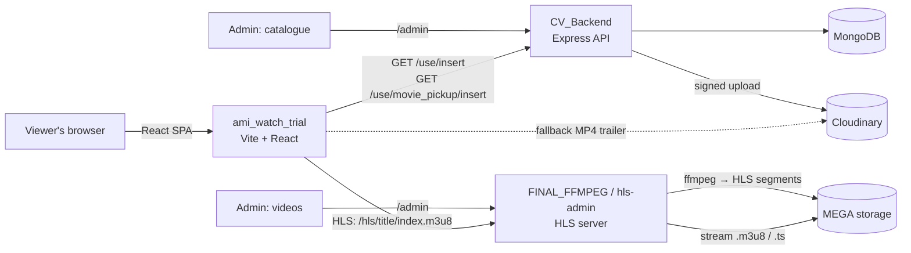

# 🎬 Ami Watch

**Ami Watch** is a full-stack movie & anime streaming platform. Users can browse a catalogue, search and filter titles, watch trailers, save titles to a watchlist and stream videos over **HLS** (HTTP Live Streaming). Content is managed through password-protected **admin panels**, and the videos themselves are converted with **ffmpeg** and stored on **MEGA**.

The project is split into four independently deployable parts:

| # | Folder | Role | Stack |
|---|--------|------|-------|
| 1 | `ami_watch_trial` | Public website (the streaming UI) | React 19, Vite, Tailwind, Swiper, Video.js |
| 2 | `CV_Backend` | Catalogue REST API + catalogue admin panel | Node, Express 5, MongoDB (Mongoose), Cloudinary |
| 3 | `FINAL_FFMPEG` | HLS delivery server + MEGA file-manager admin | Node, Express 5, megajs |
| 4 | `hls-admin` | Upgraded HLS server: file manager **+ ffmpeg conversion queue** + React player | Node, Express 5, megajs, ffmpeg, React |

---

## 🏗 Architecture



**Playback flow**

1. The home page loads the catalogue from `CV_Backend` (falls back to bundled JSON if the API is down).
2. Clicking **Play** opens `/Video/:title`.
3. The player (Video.js) requests `https://<hls-server>/hls/<title>/index.m3u8`.
4. The HLS server finds the folder named `<title>` in MEGA and pipes the playlist and `.ts` segments to the browser.
5. If HLS fails, the player automatically falls back to an MP4 trailer hosted on Cloudinary.

---

## ✨ Features

### Viewer website
- 🎞 Hero carousel (Swiper, autoplay) and "Top picks" slider
- 🔍 Live search with 250 ms debounce, poster/genre/rating dropdown, `Esc` and click-outside to close
- 🧭 Browse page with genre tabs, Sub/Dub filter and sorting (Top Rated, A–Z, Latest)
- 📄 Movie detail page: cast, director, metadata tabs, auto-playing trailer preview with countdown, trailer modal
- ▶️ HLS video player with MP4 fallback and an "Up Next" row
- 🔖 Watchlist (saved in `localStorage`, live badge count in the navbar)
- 👤 Login / Signup / OTP / Google sign-in screens (simulated, see limitations)
- 💳 Pricing page with a simulated checkout (Card / Google Pay / PayPal)
- 🌀 Smooth scrolling with Lenis, scroll-to-top on every route change
- 🛟 **Resilient data layer**: live API first, local JSON fallback

### Catalogue admin (`CV_Backend`)
- Password login → signed 12-hour token
- Create / read / update / delete for **movies** and **pickups**
- Signed Cloudinary upload parameters so the browser uploads images/videos directly to Cloudinary

### Video admin (`FINAL_FFMPEG` / `hls-admin`)
- MEGA file manager: browse folders, create, rename, delete, upload
- `hls-admin` only: **Convert video** – upload any video, the server runs ffmpeg → HLS → uploads to MEGA, with live job progress

---

## 📁 Project structure

### 1. `ami_watch_trial` (frontend)
```
src/
├── main.jsx                  # React entry point
├── App.jsx                   # Router, Lenis smooth scroll, layout (Navbar + Routes + Footer)
├── Pages/Home.jsx            # Home: hero carousel, top picks, shelves, CTA banner
├── component/
│   ├── Navbar.jsx            # Search, Browse menu, user menu, watchlist badge, mobile menu
│   ├── Mov.jsx               # /Movies – grid with filters, sorting, watchlist toggle
│   ├── Movs.jsx              # /Movies/:id – detail page + built-in movie database + trailer
│   ├── Page1.jsx             # /Video/:id – Video.js HLS player + fallback + Up Next
│   ├── Watchlist.jsx         # /Watchlist
│   ├── Pricing.jsx           # /Pricing – plans + simulated checkout
│   ├── Login.jsx / Signup.jsx# Simulated auth (stores user in localStorage)
│   ├── Crousal.jsx           # Hero slide
│   ├── Movies.jsx            # Poster card
│   ├── Detailed_description.jsx, Footer.jsx, ScrollToTop.jsx, …
├── utils/watchlist.js        # localStorage helpers: watchlist + current user
├── assets/Movies_info/       # Offline fallback catalogue (JSON)
└── Pages_css/                # CSS / CSS Modules
public/Movie_content/         # Local poster images
```

**Routes**

| Path | Component | Purpose |
|------|-----------|---------|
| `/` | `Home` | Landing page |
| `/Movies` | `Mov` | Browse & filter |
| `/Movies/:id` | `Movs` | Movie details |
| `/Video/:id` | `Page1` | Player |
| `/Watchlist` | `Watchlist` | Saved titles |
| `/Pricing` | `Pricing` | Subscription plans |
| `/Login`, `/Signup` | `Login`, `Signup` | Auth screens |

**Local storage keys:** `ami_watch_watchlist`, `ami_watch_user`, `ami_watch_subscription`.
Components stay in sync through custom browser events: `ami-watchlist-updated` and `ami-user-updated`.

### 2. `CV_Backend` (API)
```
index.js                  # Express app, CORS, mounts routes, connects DB (Vercel-ready)
routes/routes.js          # Public API  → /use/*
routes/admin.js           # Protected CRUD + Cloudinary signature → /admin/api/*
controller/Controller.js  # Insert / fetch handlers
middleware/adminAuth.js   # HMAC-signed token login + verify
model/                    # Mongoose models: Content, Movie_pickup, DB connection
admin/index.html          # Catalogue admin UI (served at /admin)
```

**Public endpoints**

| Method | Path | Description |
|--------|------|-------------|
| GET | `/use/insert` | All movies |
| GET | `/use/insert/:name` | Search movies by name (case-insensitive regex) |
| POST | `/use/insert` | Add a movie |
| GET | `/use/movie_pickup/insert` | All "top pick" entries |
| POST | `/use/movie_pickup/insert` | Add a pick |

**Admin endpoints** (`Authorization: Bearer <token>`)

| Method | Path | Description |
|--------|------|-------------|
| POST | `/admin/api/login` | `{ password }` → `{ token }` (valid 12 h) |
| GET | `/admin/api/upload/signature` | Signed Cloudinary upload params |
| GET / POST | `/admin/api/:resource` | List / create (`movies` or `pickups`) |
| PUT / DELETE | `/admin/api/:resource/:id` | Update / delete |

**Data models**

- `Content` – `Poster, Movie, Features[], Genres[], Description, Dir, Cast[], Language, Year, Rating, Age, Image, Video` (+ timestamps)
- `Movie_pickup` – `Movie_poster, Movie_title, Movie_feature` (+ timestamps)

### 3. `FINAL_FFMPEG` (HLS server)
```
index.js                  # Logs into MEGA, serves /hls/:folder/:file
admin.js                  # Admin API (login, list, mkdir, rename, delete, upload, stats)
public/admin/index.html   # File-manager UI
cache/                    # Sample pre-converted HLS output (index.m3u8 + segment000.ts)
```
- `GET /hls/:folderName/:filename` streams a file from MEGA with the correct MIME type (`.m3u8` → `application/vnd.apple.mpegurl`, `.ts` → `video/MP2T`).
- Admin tokens are HMAC-signed; login is rate-limited (8 attempts / 15 min / IP).

### 4. `hls-admin` (HLS server v2)
Everything in `FINAL_FFMPEG`, plus:
```
transcode.js              # ffmpeg wrapper + sequential job queue
frontend/                 # Small React + Video.js player (lists videos from /api/videos)
test.js                   # End-to-end tests (in-memory MEGA fake + real ffmpeg)
```
- `PUT /admin/api/transcode?name=<folder>&filename=<file>` – streams the upload to disk, queues an ffmpeg job (H.264/AAC, 10 s segments, VOD playlist), uploads segments then `index.m3u8` to MEGA, then cleans up.
- `GET /api/jobs` / `GET /api/jobs/:id` – job status and progress.
- `GET /api/videos` – public list of folders containing an `index.m3u8`.
- Re-converting a name replaces the old version **only after** the new one succeeds.

---

## 🚀 Getting started

**Requirements:** Node.js 18+ (22 recommended for `CV_Backend`), a MongoDB database, a MEGA account, a Cloudinary account, and **ffmpeg** (only for `hls-admin` conversion).

### 1. Catalogue API
```bash
cd CV_Backend
cp .env.example .env     # fill in the values
npm install
npm run dev              # http://localhost:3000   (admin at /admin)
```

### 2. HLS server
```bash
cd hls-admin             # or FINAL_FFMPEG
cp .env.example .env     # fill in the values
npm install
npm run build:frontend   # hls-admin only – builds the React player
npm start                # admin at /admin
```

### 3. Website
```bash
cd ami_watch_trial
npm install
npm run dev              # http://localhost:3000
npm run build            # production build → dist/
```

### Environment variables

**`CV_Backend/.env`**
```env
MONGODB_=your-mongodb-connection-string
ADMIN_PASSWORD=choose-a-long-password
ADMIN_SECRET=any-long-random-string
CLOUDINARY_CLOUD_NAME=your-cloud-name
CLOUDINARY_API_KEY=your-api-key
CLOUDINARY_API_SECRET=your-api-secret
CLOUDINARY_FOLDER=ami_watch        # optional
```

**`hls-admin/.env`**
```env
PORT=3000
MEGA_EMAIL=your-mega-email
MEGA_PASSWORD=your-mega-password
ADMIN_USER=admin
ADMIN_PASSWORD=change-me
ADMIN_SECRET=long-random-string
# optional: FFMPEG_PATH, FFPROBE_PATH, WORK_DIR
```

**`FINAL_FFMPEG/.env`**
```env
PORT=3000
USER=your-mega-email          # note: may clash with the OS $USER variable
PASSWORD=your-mega-password
ADMIN_USER=admin
ADMIN_PASSWORD=change-me
ADMIN_SECRET=long-random-string
```

> ⚠️ Never commit `.env` files or put real credentials in `.env.example`.

### Connecting the pieces
The frontend currently has the API and HLS URLs written directly in the code:
- Catalogue API: `https://cv-backend-theta.vercel.app` (in `Home.jsx`, `Mov.jsx`, `Movs.jsx`, `Page1.jsx`, `Navbar.jsx`)
- HLS server: `https://final-ffmpeg.vercel.app` (in `Page1.jsx`)

To use your own deployments, replace these URLs (or move them into `VITE_API_BASE_URL` – already declared in `.env.example`).

**To publish a new title:**
1. Convert it in the HLS admin (**Convert video**) using the **exact movie title** as the name (the player requests `/hls/<title>/index.m3u8`).
2. Add the movie's details in the catalogue admin (`CV_Backend` → `/admin`).

---

## ☁️ Deployment

| Part | Where | Notes |
|------|-------|-------|
| Website | Vercel / Netlify | SPA rewrites to `index.html` already configured (`vercel.json`, `netlify.toml`) |
| `CV_Backend` | Vercel | `vercel.json` included; the Express app is exported for serverless |
| `FINAL_FFMPEG` | Vercel | Works for streaming + file manager |
| `hls-admin` | A normal server / VPS | Conversion needs ffmpeg, disk space and long-running requests – **not possible on Vercel** (streaming and file manager still work there) |

---

## ⚠️ Known limitations & roadmap

**Current limitations**
- **Auth and payments are simulated.** Login/Signup/OTP/Google sign-in only write to `localStorage`; any email + password is accepted, and no payment is processed.
- **Watchlist is per-browser** (not synced to an account).
- Public `POST /use/insert` and `/use/movie_pickup/insert` have **no authentication** – anyone can add data. Protect them or remove them in favour of the admin API.
- `Insert_Content` / `Insert_Moive_Pick_Up` don't `return` after sending the "already exists" 400 response, so a duplicate still tries to insert and responds twice.
- Video quality badges ("1080p", "Dolby 5.1") on the player page are static labels; only a single rendition is produced (no adaptive bitrate ladder).
- API/HLS URLs are hard-coded in the frontend.
- `CORS` is open to all origins.

**Roadmap** (from `plan.md`)
- [ ] Responsive WebP/AVIF images and hero preloading
- [ ] PWA (manifest + service worker)
- [ ] SEO / OpenGraph per movie page, `Movie` & `VideoObject` JSON-LD
- [ ] Real authentication (e.g. Firebase Auth) and server-side watchlists
- [ ] Resume playback and custom player controls
- [ ] Multi-bitrate HLS (360p / 720p / 1080p)

---

## 🛠 Tech stack

**Frontend:** React 19 · Vite 6 · React Router 7 · Tailwind CSS 3 · MUI · Swiper 11 · Video.js 8 · GSAP · Lenis
**Backend:** Node.js · Express 5 · Mongoose 9 · MongoDB · megajs · ffmpeg · Cloudinary
**Hosting:** Vercel · Netlify

---

## 📄 License

ISC (backend packages). Add a license file for the full project if you plan to make it public.
